# Push-T Lowdim 20-Episode Fair Compare

## Summary

| Experiment | Monitor | Best | Last Train Loss | Last Action MSE | Last Exec Action MSE | Rollout Success | Rollout Final Coverage | Rollout Max Reward | Best Final Coverage | Checkpoint |
| --- | --- | ---: | ---: | ---: | ---: | ---: | ---: | ---: | ---: | --- |
| pusht_lowdim_bc_phase6_full_20eps300 | exec_action_mse (min) | 1142.169647 | 0.034821 | 1533.332947 | 1142.169647 | 0.000000 | 0.440688 | 0.548064 | 0.931030 | outputs/pusht_lowdim_bc_phase6_full/best.pt |
| pusht_lowdim_bc_phase9_rollout_topk_20eps300 | rollout_mean_final_coverage (max) | 0.491018 | 0.034821 | 1642.511353 | 1285.486206 | 0.100000 | 0.434843 | 0.505188 | 0.964615 | outputs/pusht_lowdim_bc_phase9_rollout_topk/best.pt |

## Best Epochs

### pusht_lowdim_bc_phase6_full_20eps300

- Best epoch: 22
- exec_action_mse: 1142.169647
- action_mae: 25.128861
- exec_action_mae: 21.745742
- rollout_success_rate: 0.000000
- rollout_mean_final_coverage: 0.440688
- rollout_mean_max_reward: 0.548064
- rollout_mean_max_coverage: 0.520661
- rollout_best_final_coverage: 0.931030

### pusht_lowdim_bc_phase9_rollout_topk_20eps300

- Best epoch: 25
- rollout_mean_final_coverage: 0.491018
- action_mae: 26.167533
- exec_action_mse: 1285.486206
- exec_action_mae: 23.206739
- rollout_success_rate: 0.100000
- rollout_mean_final_coverage: 0.434843
- rollout_mean_max_reward: 0.505188
- rollout_mean_max_coverage: 0.480867
- rollout_best_final_coverage: 0.964615

## Rollout Coverage Bands

| Experiment | Episodes | >=0.25 | >=0.50 | >=0.75 | >=0.90 | >=0.95 | Best Final Coverage | Mean Contacts/Step |
| --- | ---: | ---: | ---: | ---: | ---: | ---: | ---: | ---: |
| pusht_lowdim_bc_phase6_full_20eps300 | 20 | 13 | 10 | 4 | 1 | 0 | 0.931030 | 0.361000 |
| pusht_lowdim_bc_phase9_rollout_topk_20eps300 | 20 | 11 | 8 | 7 | 4 | 2 | 0.964615 | 0.266145 |

## Training Plots

### train_loss

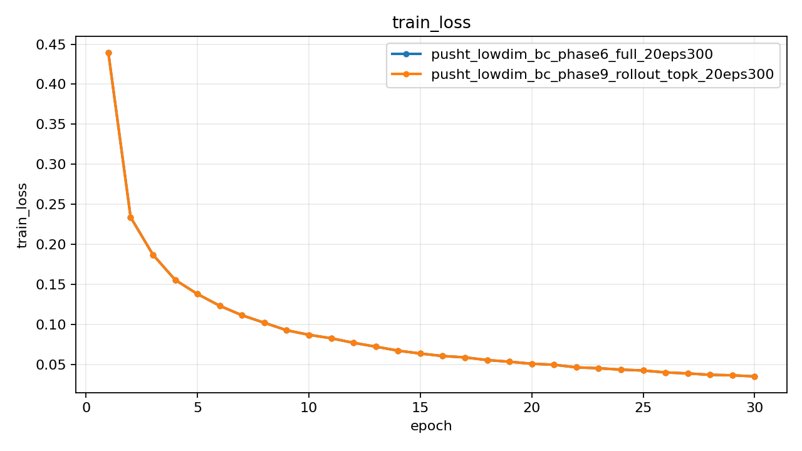

### action_mse

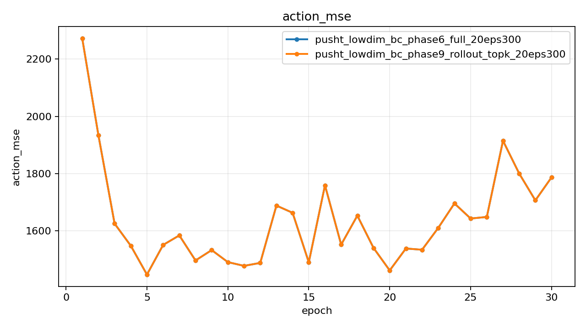

### action_mae

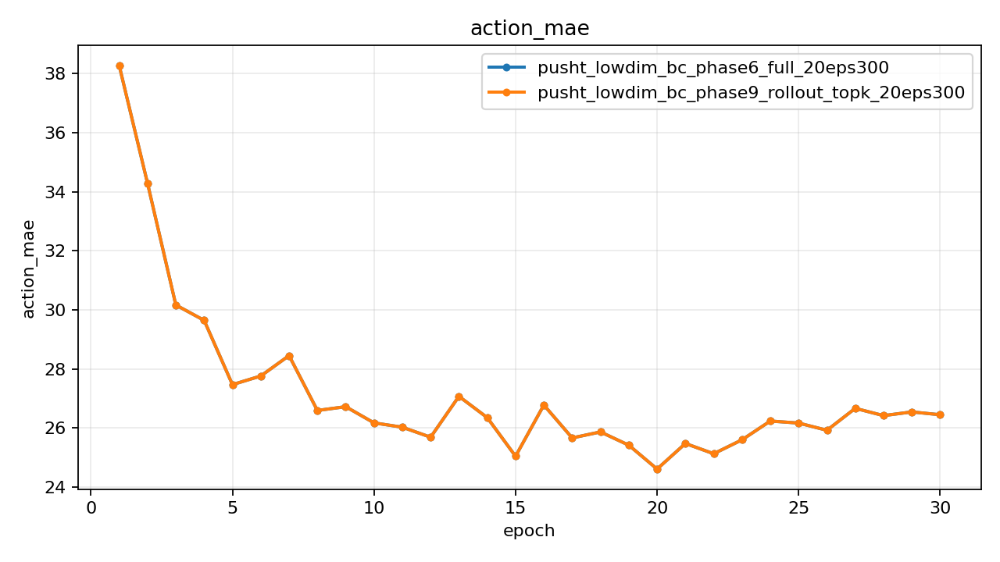

### terminal_action_l2

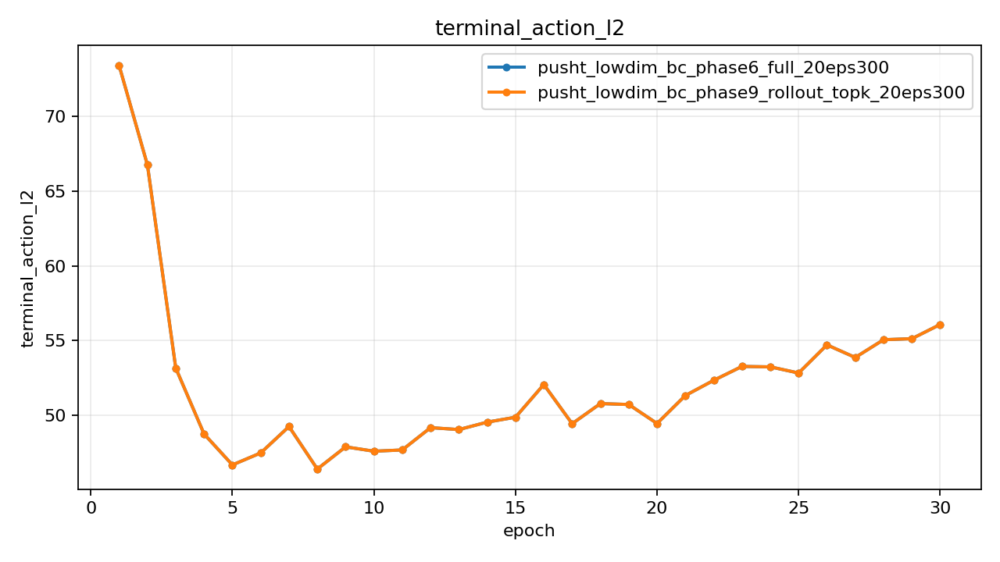

### exec_action_mse

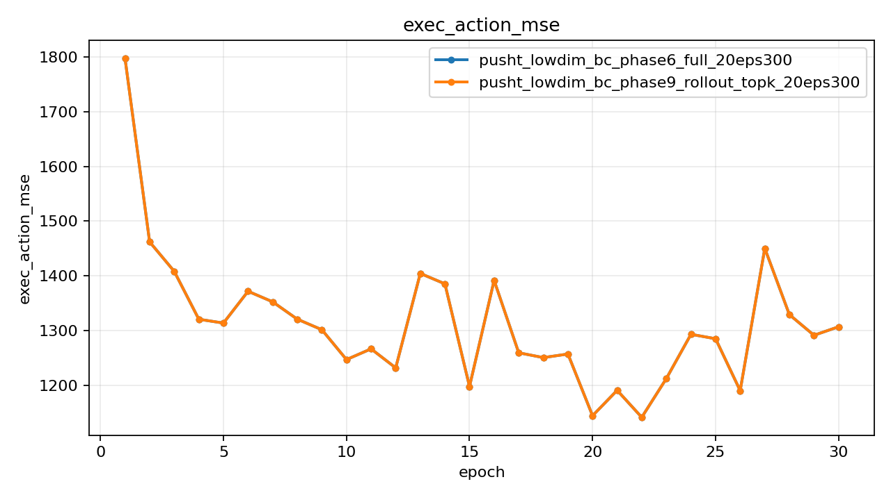

### exec_action_mae

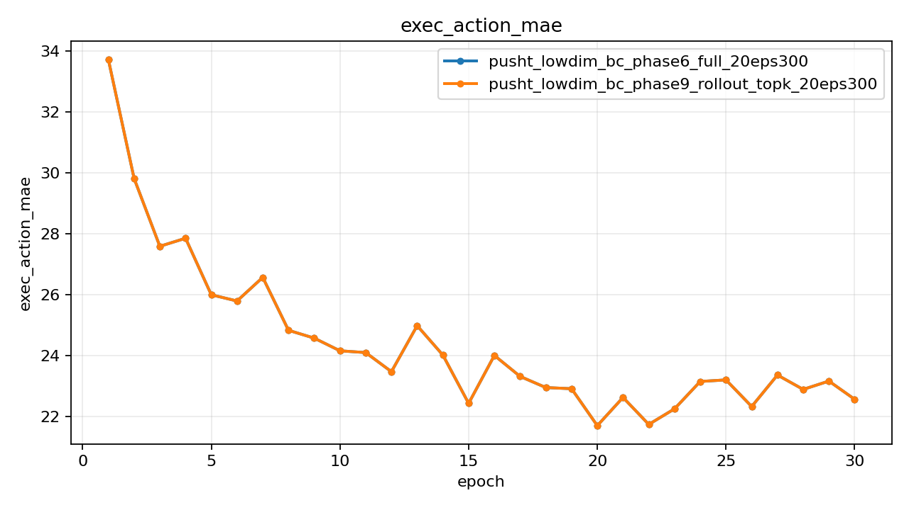

### exec_terminal_action_l2

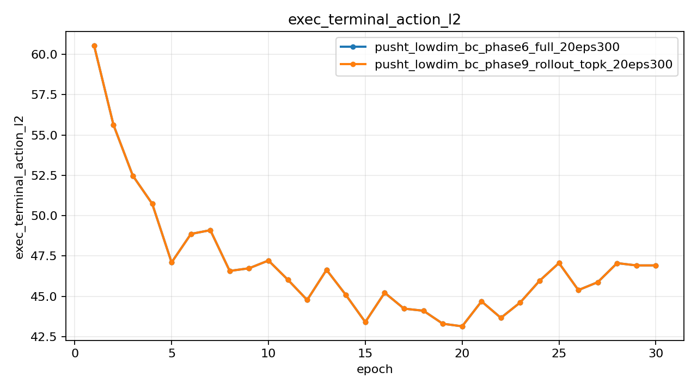

### rollout_success_rate

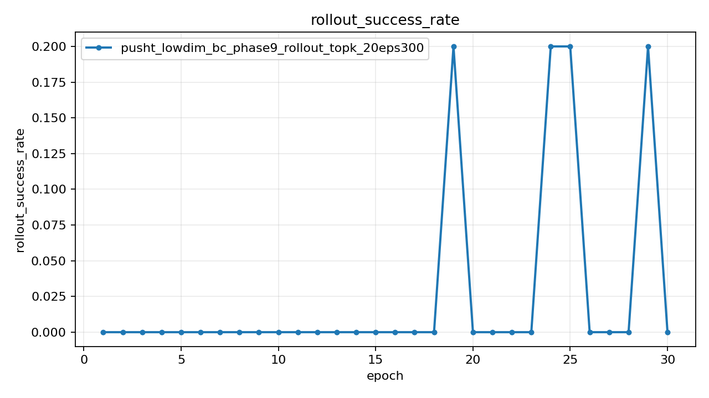

### rollout_mean_final_reward

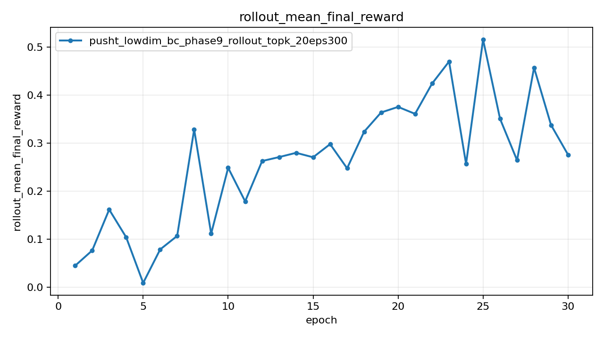

### rollout_mean_max_reward

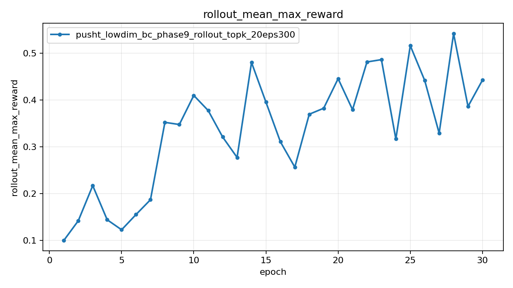

### rollout_mean_final_coverage

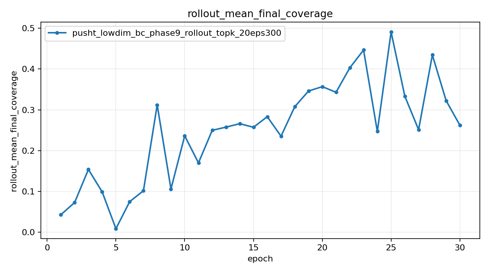

### rollout_mean_max_coverage

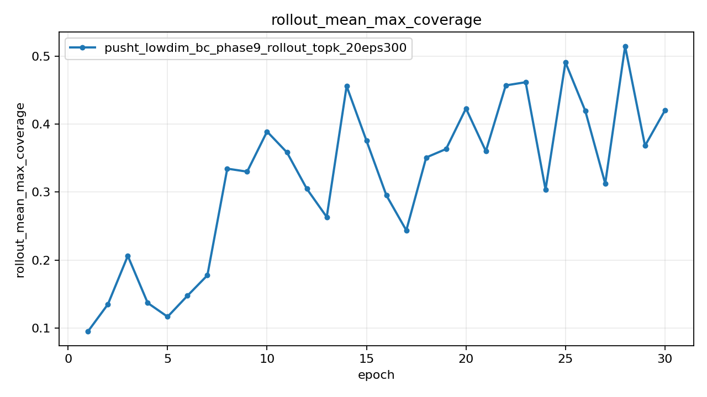

### rollout_max_final_coverage

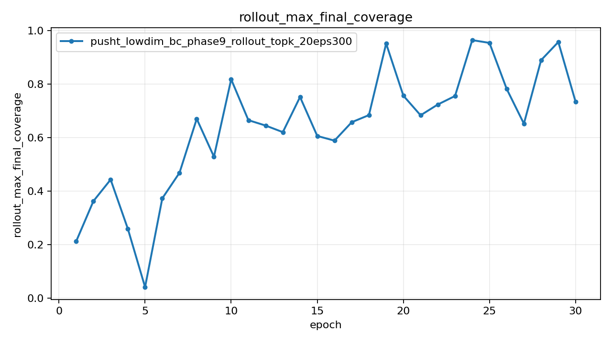

## Rollout Diagnostics

### rollout_final_coverage

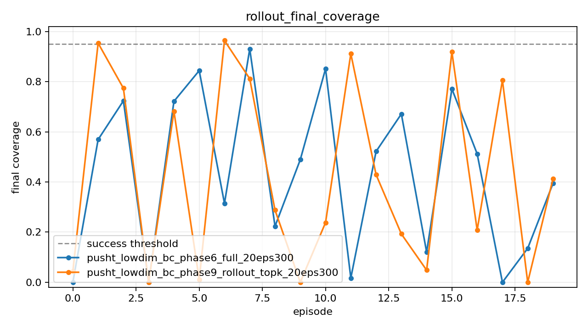

### rollout_mean_coverage

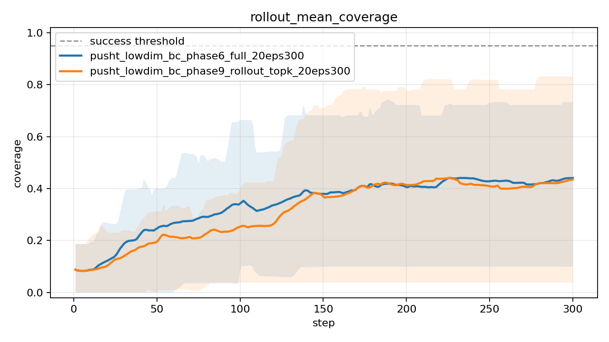

### pusht_lowdim_bc_phase6_full_20eps300

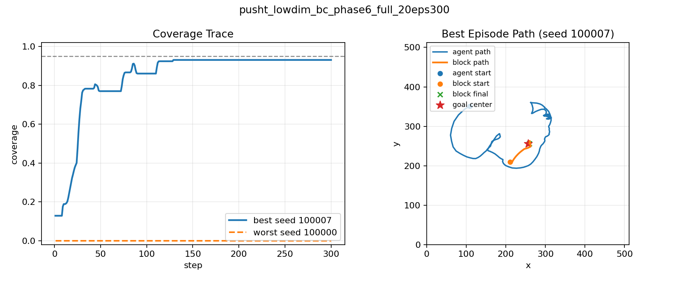

### pusht_lowdim_bc_phase9_rollout_topk_20eps300

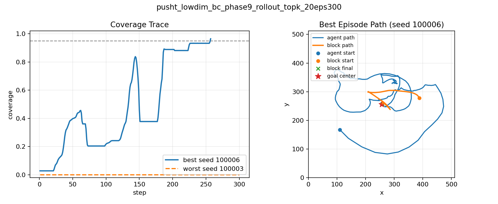
