# Push-T Lowdim Controller Compare

## Summary

| Experiment | Monitor | Best | Last Train Loss | Last Action MSE | Last Exec Action MSE | Rollout Success | Rollout Final Coverage | Rollout Max Reward | Best Final Coverage | Checkpoint |
| --- | --- | ---: | ---: | ---: | ---: | ---: | ---: | ---: | ---: | --- |
| pusht_lowdim_bc_phase6_full | exec_action_mse (min) | 1142.169647 | 0.034821 | 1533.332947 | 1142.169647 | 0.000000 | 0.481787 | 0.620057 | 0.931030 | outputs/pusht_lowdim_bc_phase6_full/best.pt |
| pusht_lowdim_bc_phase6_stabilize | exec_action_mse (min) | 1142.169647 | 0.034821 | 1533.332947 | 1142.169647 | 0.000000 | 0.534719 | 0.608172 | 0.866855 | outputs/pusht_lowdim_bc_phase6_full/best.pt |
| pusht_lowdim_diffusion_unet_dev_phase4_exec | exec_action_mse (min) | 3578.291504 | 0.208668 | 4276.798340 | 3723.637085 | 0.000000 | 0.000006 | 0.110522 | 0.000063 | outputs/pusht_lowdim_diffusion_unet_dev_phase4_exec/best.pt |

## Best Epochs

### pusht_lowdim_bc_phase6_full

- Best epoch: 22
- exec_action_mse: 1142.169647
- action_mae: 25.128861
- exec_action_mae: 21.745742
- rollout_success_rate: 0.000000
- rollout_mean_final_coverage: 0.481787
- rollout_mean_max_reward: 0.620057
- rollout_mean_max_coverage: 0.589054
- rollout_best_final_coverage: 0.931030

### pusht_lowdim_bc_phase6_stabilize

- Best epoch: 22
- exec_action_mse: 1142.169647
- action_mae: 25.128861
- exec_action_mae: 21.745742
- rollout_success_rate: 0.000000
- rollout_mean_final_coverage: 0.534719
- rollout_mean_max_reward: 0.608172
- rollout_mean_max_coverage: 0.577764
- rollout_best_final_coverage: 0.866855

### pusht_lowdim_diffusion_unet_dev_phase4_exec

- Best epoch: 3
- exec_action_mse: 3578.291504
- action_mae: 50.048500
- exec_action_mae: 47.568628
- rollout_success_rate: 0.000000
- rollout_mean_final_coverage: 0.000006
- rollout_mean_max_reward: 0.110522
- rollout_mean_max_coverage: 0.104996
- rollout_best_final_coverage: 0.000063

## Rollout Coverage Bands

| Experiment | Episodes | >=0.25 | >=0.50 | >=0.75 | >=0.90 | >=0.95 | Best Final Coverage | Mean Contacts/Step |
| --- | ---: | ---: | ---: | ---: | ---: | ---: | ---: | ---: |
| pusht_lowdim_bc_phase6_full | 10 | 7 | 5 | 2 | 1 | 0 | 0.931030 | 0.352667 |
| pusht_lowdim_bc_phase6_stabilize | 10 | 7 | 6 | 4 | 0 | 0 | 0.866855 | 0.337000 |
| pusht_lowdim_diffusion_unet_dev_phase4_exec | 10 | 0 | 0 | 0 | 0 | 0 | 0.000063 | 0.475667 |

## Training Plots

### train_loss

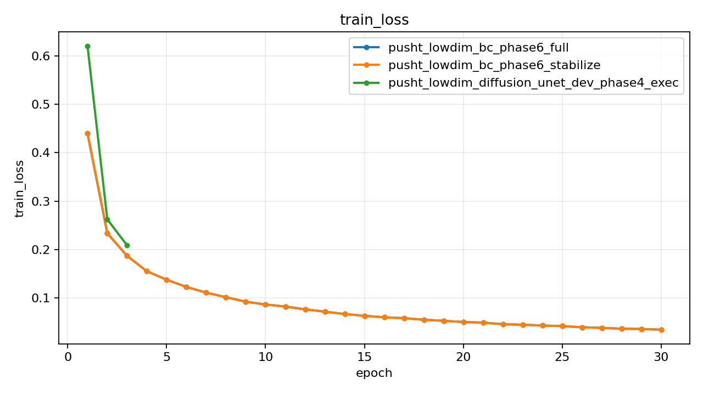

### action_mse

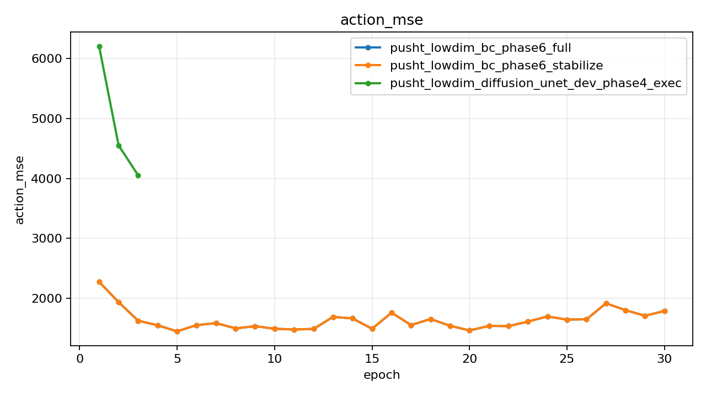

### action_mae

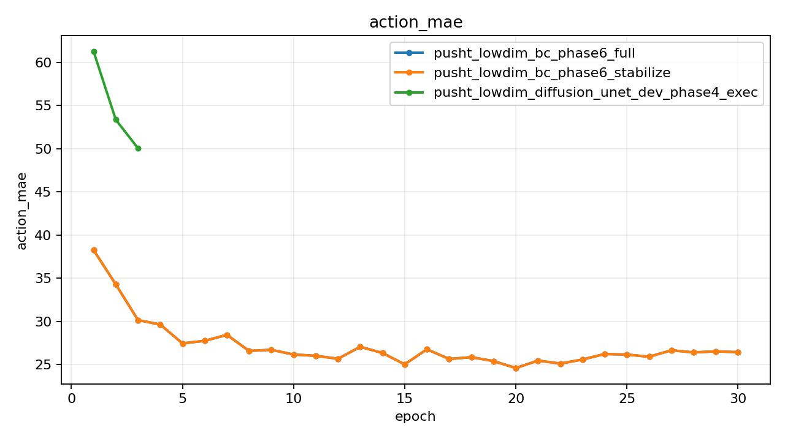

### terminal_action_l2

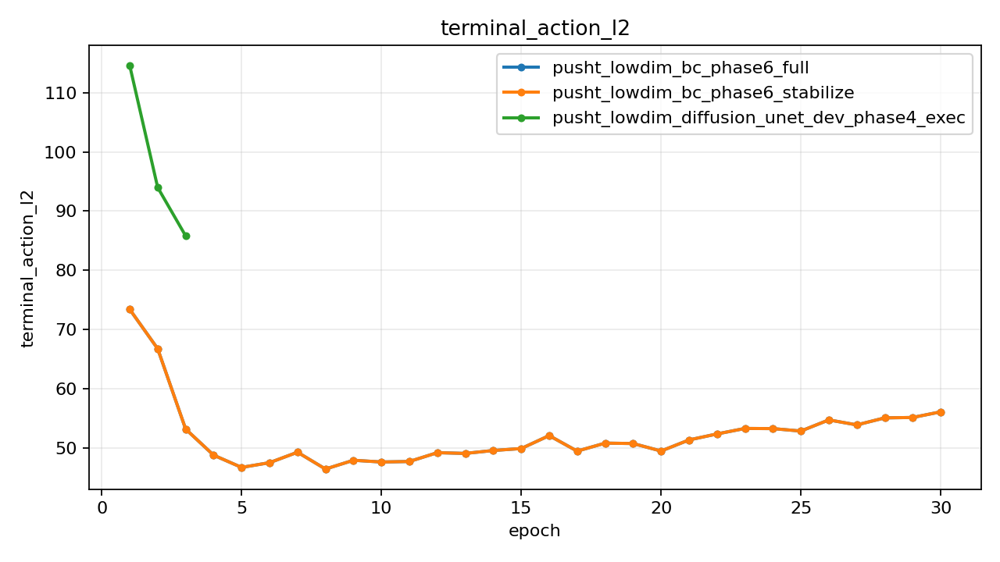

### exec_action_mse

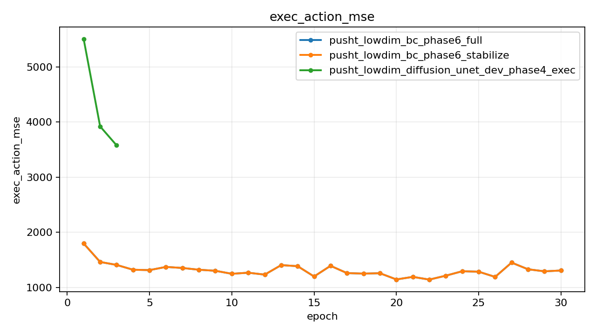

### exec_action_mae

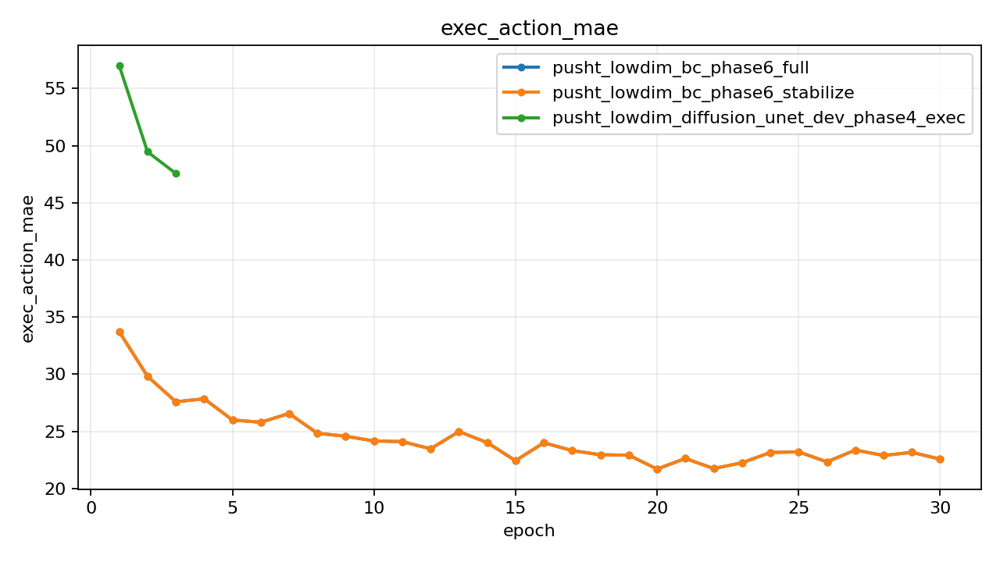

### exec_terminal_action_l2

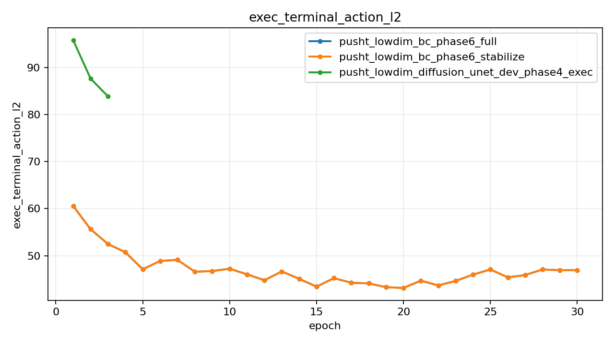

## Rollout Diagnostics

### rollout_final_coverage

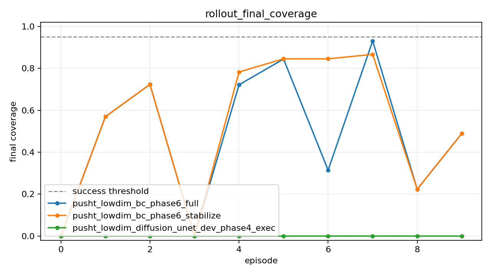

### rollout_mean_coverage

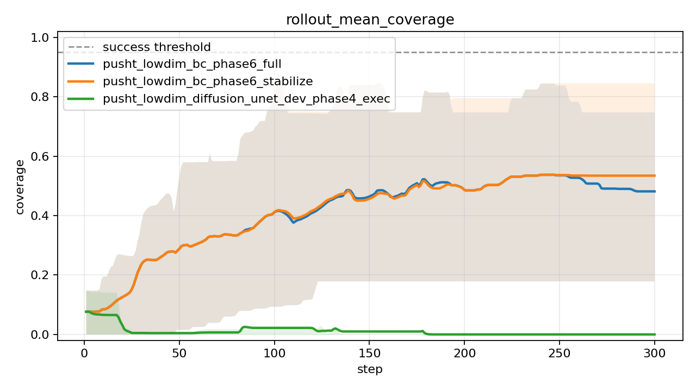

### pusht_lowdim_bc_phase6_full

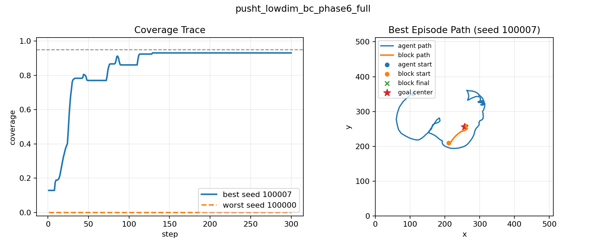

### pusht_lowdim_bc_phase6_stabilize

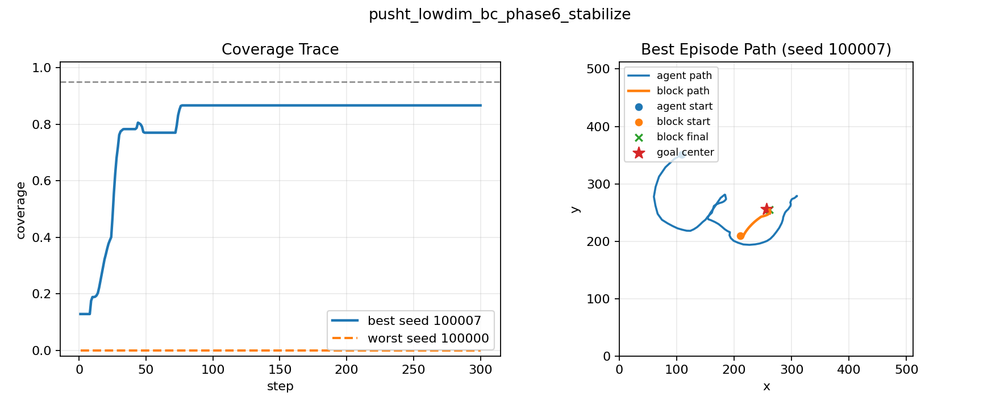

### pusht_lowdim_diffusion_unet_dev_phase4_exec

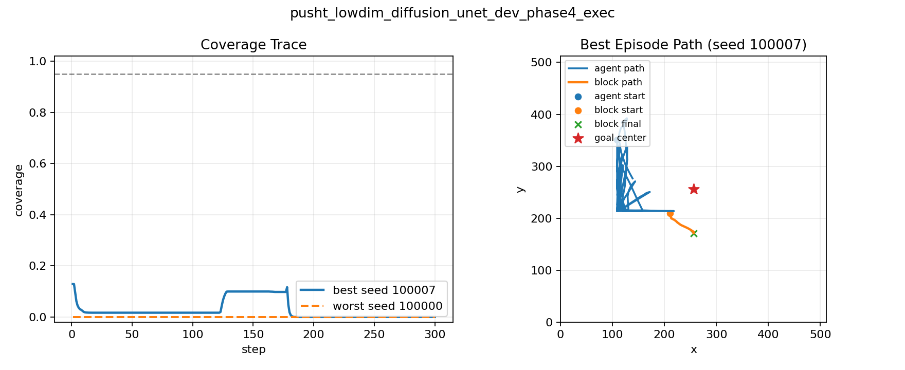
