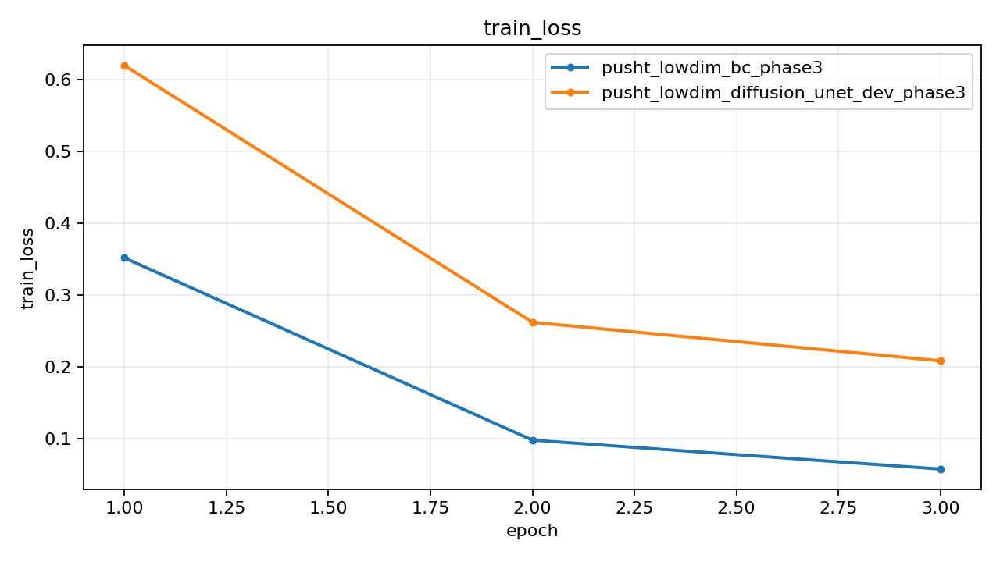
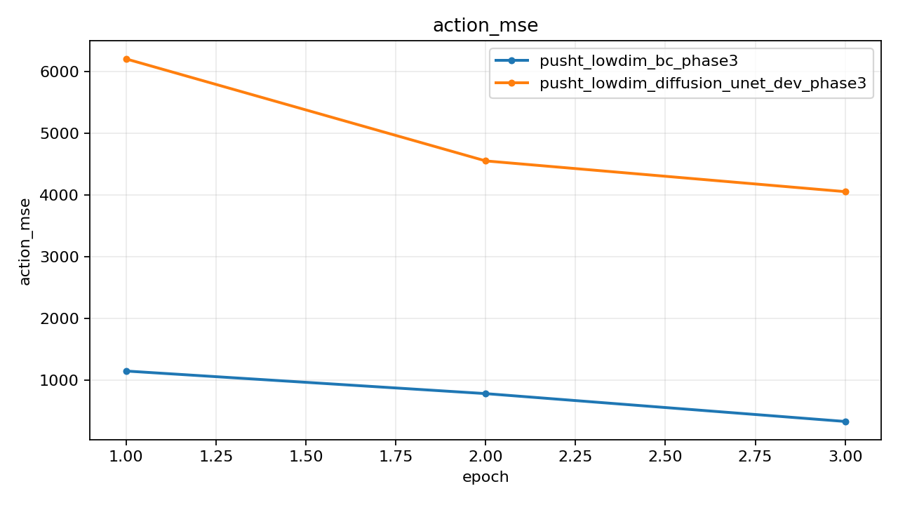
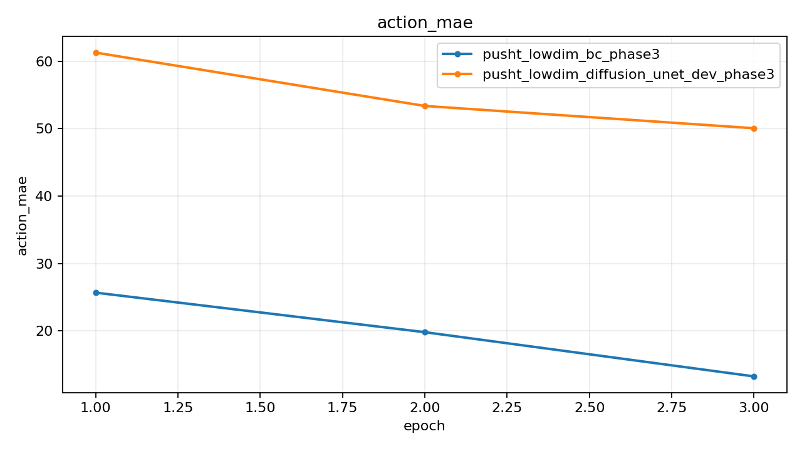
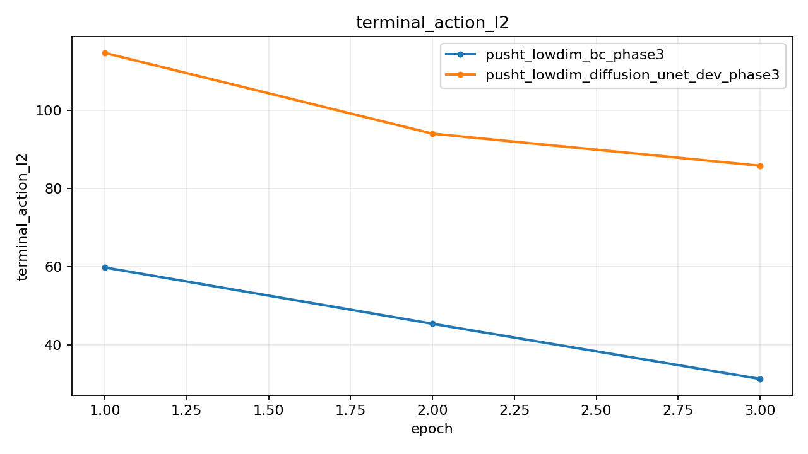

# Push-T Lowdim Phase3 Exec Report

## Summary

| Experiment | Monitor | Best | Last Train Loss | Last Action MSE | Last Exec Action MSE | Last Action MAE | Last Exec Action MAE | Checkpoint |
| --- | --- | ---: | ---: | ---: | ---: | ---: | ---: | --- |
| pusht_lowdim_bc_phase3 | action_mse (min) | 325.313080 | 0.057969 | 325.313080 | 255.840073 | 13.274440 | 11.575498 | outputs/pusht_lowdim_bc_phase3/best.pt |
| pusht_lowdim_diffusion_unet_dev_phase3 | action_mse (min) | 4053.365601 | 0.208668 | 4452.808594 | 4009.543945 | 52.750362 | 50.051794 | outputs/pusht_lowdim_diffusion_unet_dev_phase3/best.pt |

## Best Epochs

### pusht_lowdim_bc_phase3

- Best epoch: 3
- action_mse: 325.313080
- action_mae: 13.274440

### pusht_lowdim_diffusion_unet_dev_phase3

- Best epoch: 3
- action_mse: 4053.365601
- action_mae: 50.048500

## Plots

### train_loss

### action_mse

### action_mae

### terminal_action_l2

