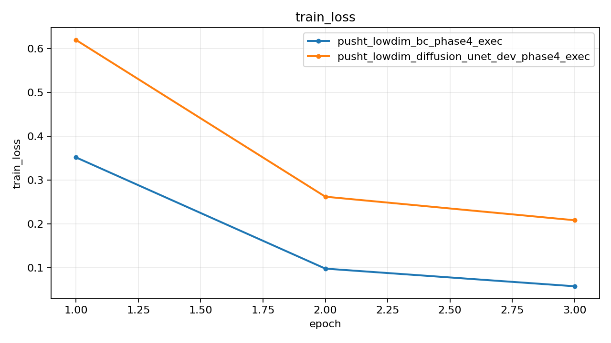
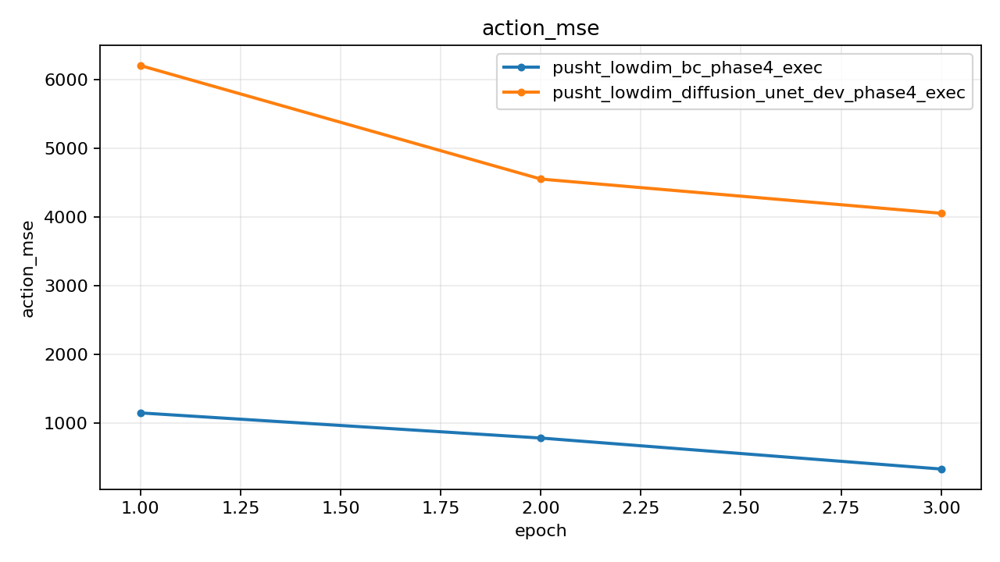
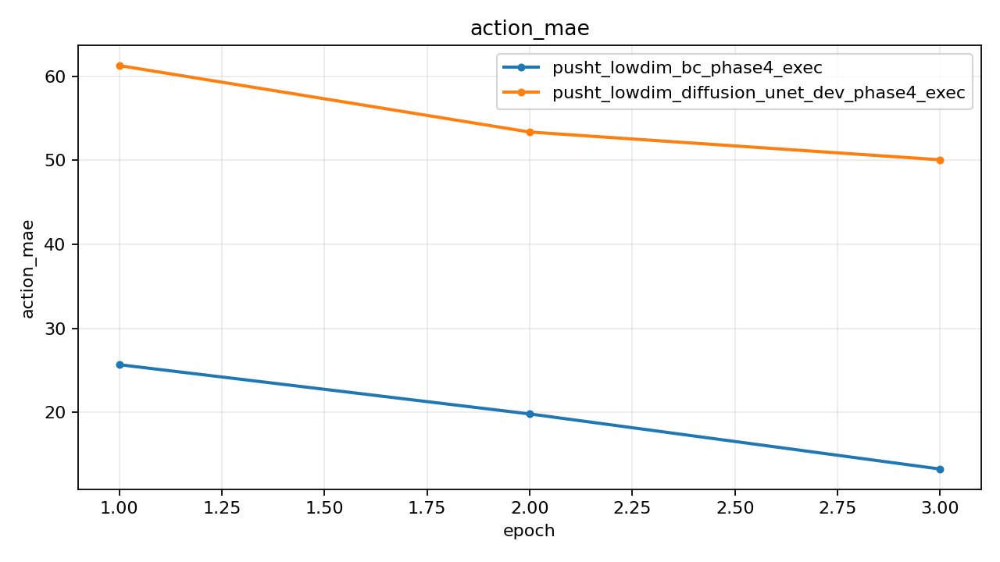
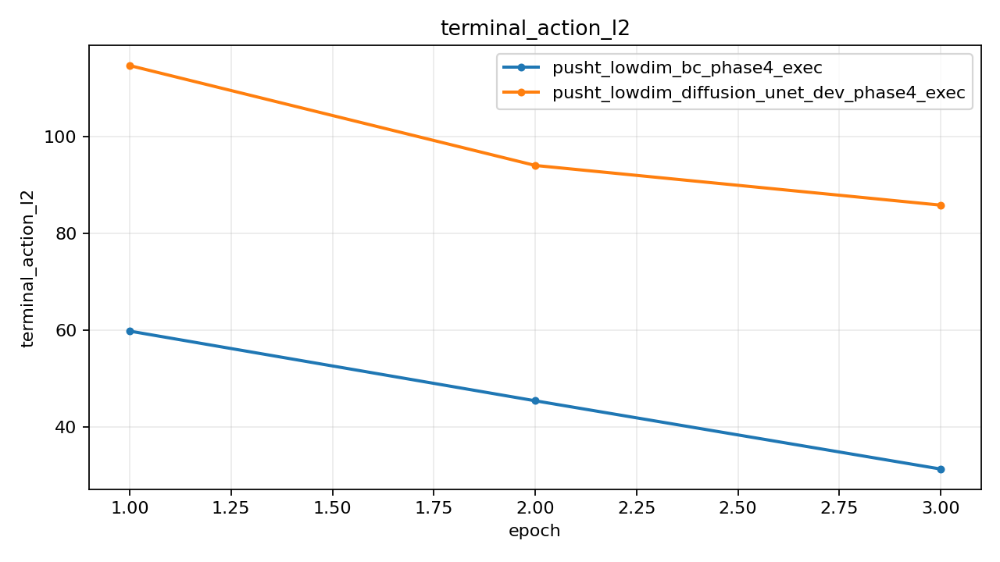
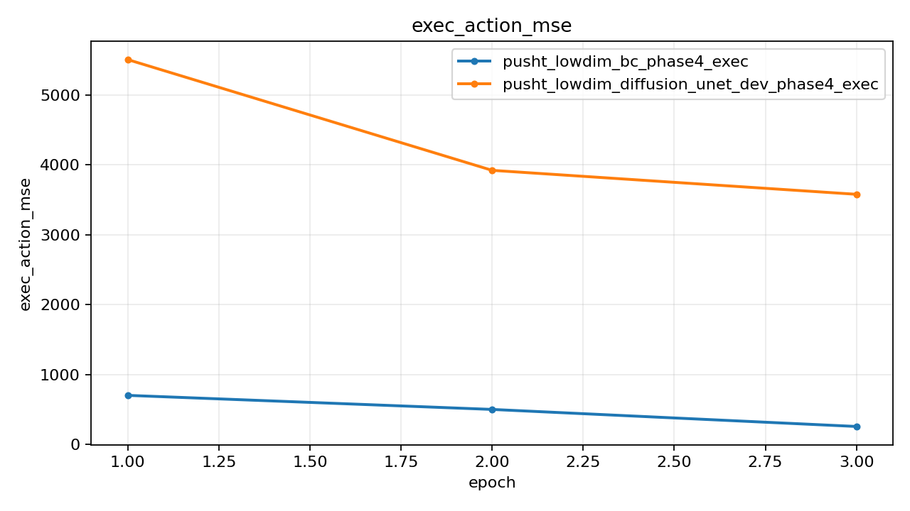
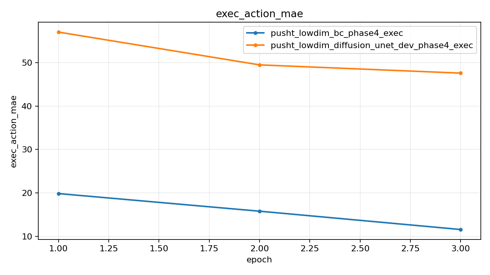
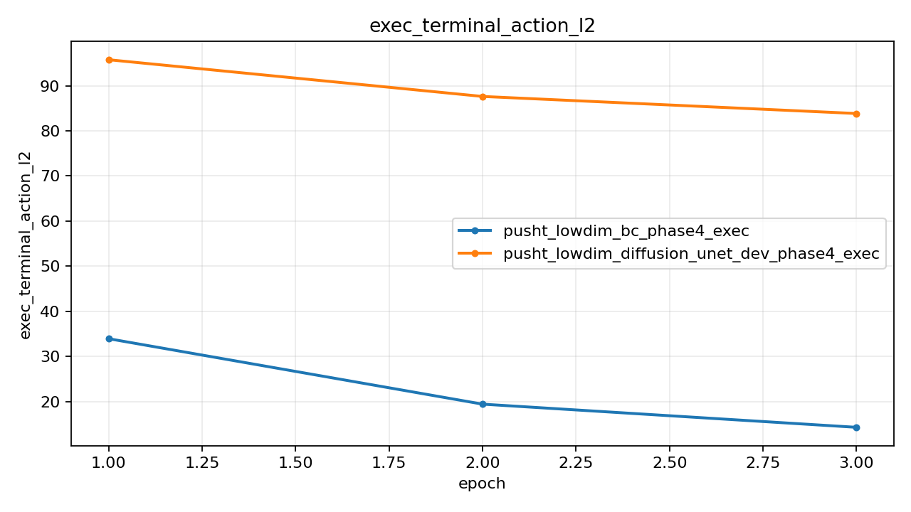

# Push-T Lowdim Phase4 Exec Report

## Summary

| Experiment | Monitor | Best | Last Train Loss | Last Action MSE | Last Exec Action MSE | Last Action MAE | Last Exec Action MAE | Checkpoint |
| --- | --- | ---: | ---: | ---: | ---: | ---: | ---: | --- |
| pusht_lowdim_bc_phase4_exec | exec_action_mse (min) | 255.840073 | 0.057969 | 325.313080 | 255.840073 | 13.274440 | 11.575498 | outputs/pusht_lowdim_bc_phase4_exec/best.pt |
| pusht_lowdim_diffusion_unet_dev_phase4_exec | exec_action_mse (min) | 3578.291504 | 0.208668 | 4276.798340 | 3723.637085 | 51.038790 | 47.875546 | outputs/pusht_lowdim_diffusion_unet_dev_phase4_exec/best.pt |

## Best Epochs

### pusht_lowdim_bc_phase4_exec

- Best epoch: 3
- exec_action_mse: 255.840073
- action_mae: 13.274440
- exec_action_mae: 11.575498

### pusht_lowdim_diffusion_unet_dev_phase4_exec

- Best epoch: 3
- exec_action_mse: 3578.291504
- action_mae: 50.048500
- exec_action_mae: 47.568628

## Plots

### train_loss

### action_mse

### action_mae

### terminal_action_l2

### exec_action_mse

### exec_action_mae

### exec_terminal_action_l2

