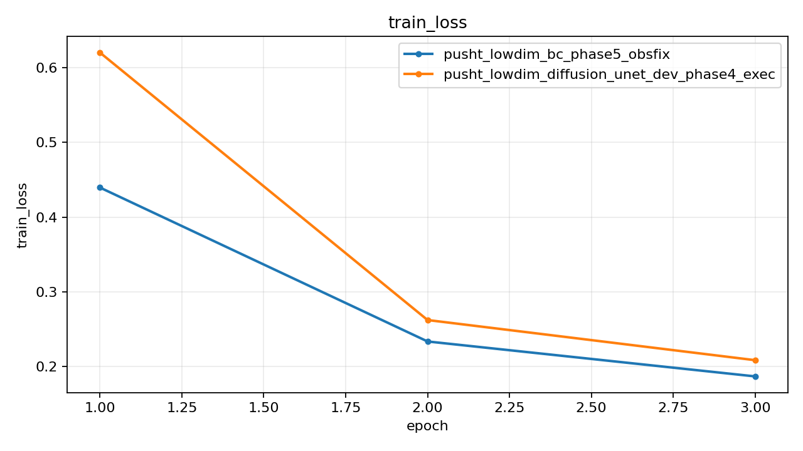
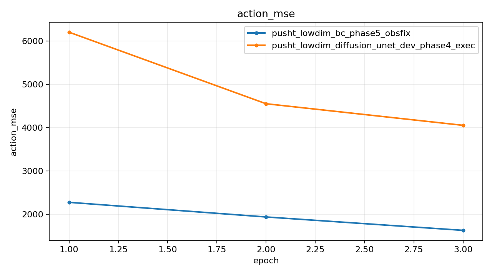
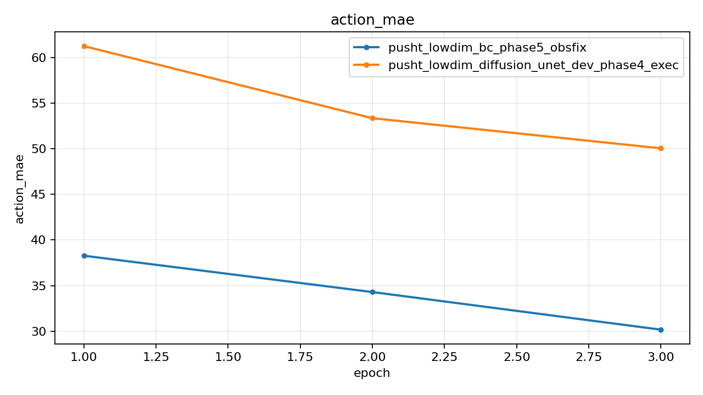
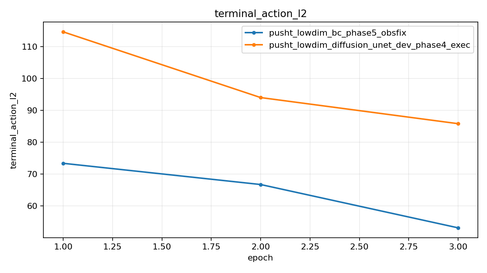
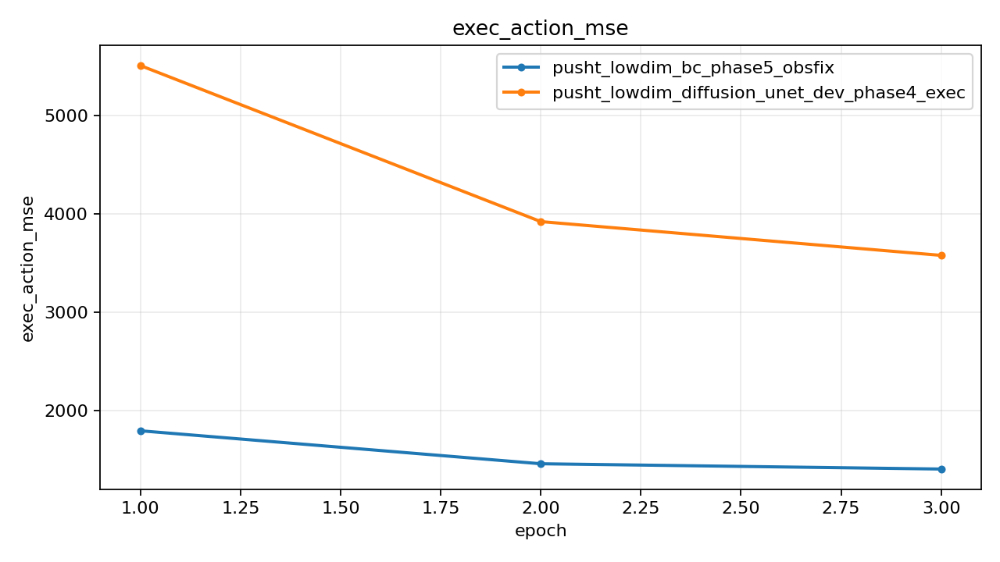
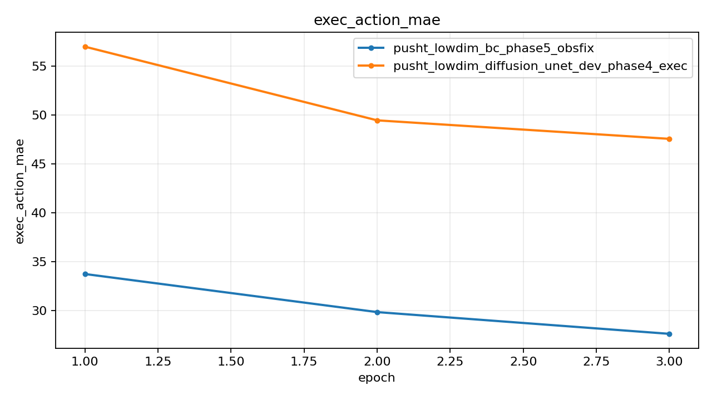
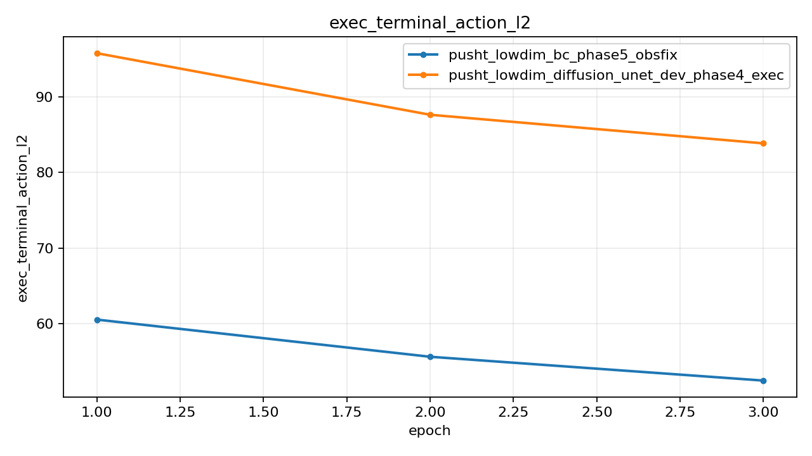

# Push-T Lowdim Rollout Compare

## Summary

| Experiment | Monitor | Best | Last Train Loss | Last Action MSE | Last Exec Action MSE | Rollout Success | Rollout Final Coverage | Rollout Max Reward | Checkpoint |
| --- | --- | ---: | ---: | ---: | ---: | ---: | ---: | ---: | --- |
| pusht_lowdim_bc_phase5_obsfix | exec_action_mse (min) | 1408.478699 | 0.186991 | 1624.730164 | 1408.478699 | 0.000000 | 0.255969 | 0.269441 | outputs/pusht_lowdim_bc_phase5_obsfix/best.pt |
| pusht_lowdim_diffusion_unet_dev_phase4_exec | exec_action_mse (min) | 3578.291504 | 0.208668 | 4276.798340 | 3723.637085 | 0.000000 | 0.000000 | 0.047317 | outputs/pusht_lowdim_diffusion_unet_dev_phase4_exec/best.pt |

## Best Epochs

### pusht_lowdim_bc_phase5_obsfix

- Best epoch: 3
- exec_action_mse: 1408.478699
- action_mae: 30.166555
- exec_action_mae: 27.591886
- rollout_success_rate: 0.000000
- rollout_mean_final_coverage: 0.255969
- rollout_mean_max_reward: 0.269441

### pusht_lowdim_diffusion_unet_dev_phase4_exec

- Best epoch: 3
- exec_action_mse: 3578.291504
- action_mae: 50.048500
- exec_action_mae: 47.568628
- rollout_success_rate: 0.000000
- rollout_mean_final_coverage: 0.000000
- rollout_mean_max_reward: 0.047317

## Plots

### train_loss

### action_mse

### action_mae

### terminal_action_l2

### exec_action_mse

### exec_action_mae

### exec_terminal_action_l2

