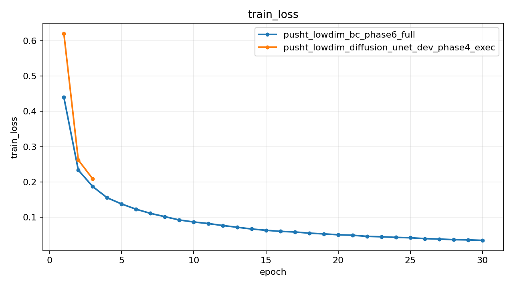
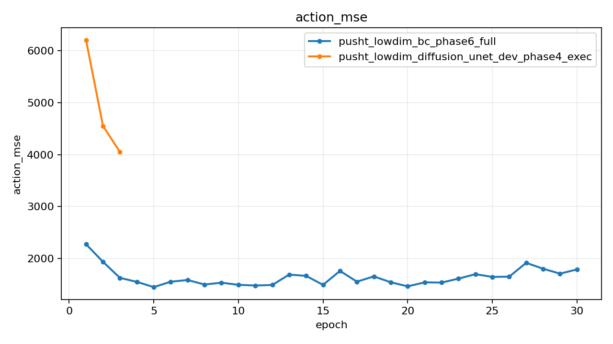
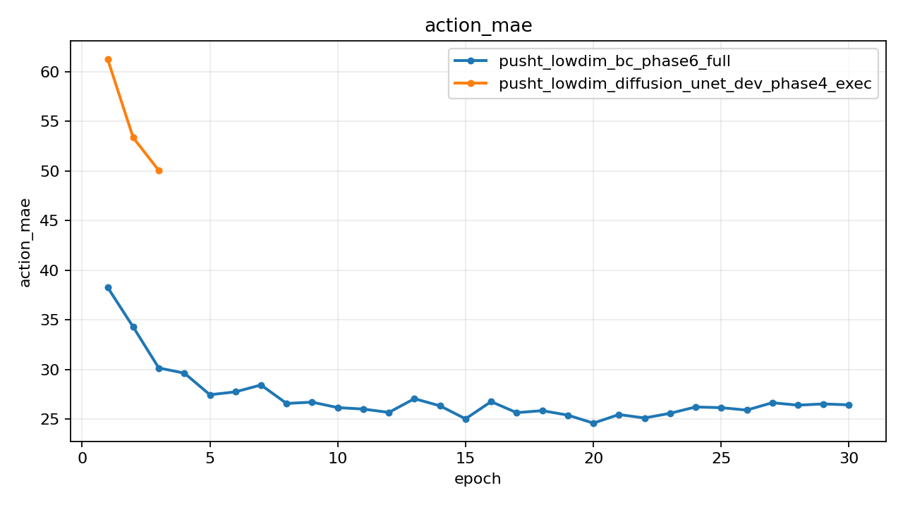
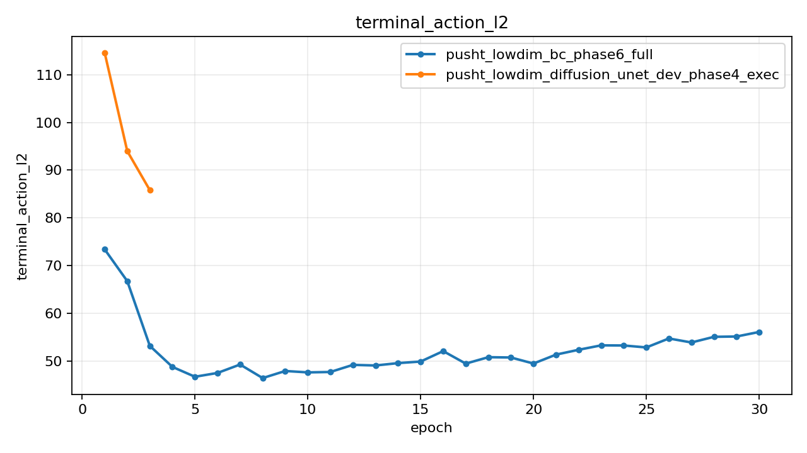
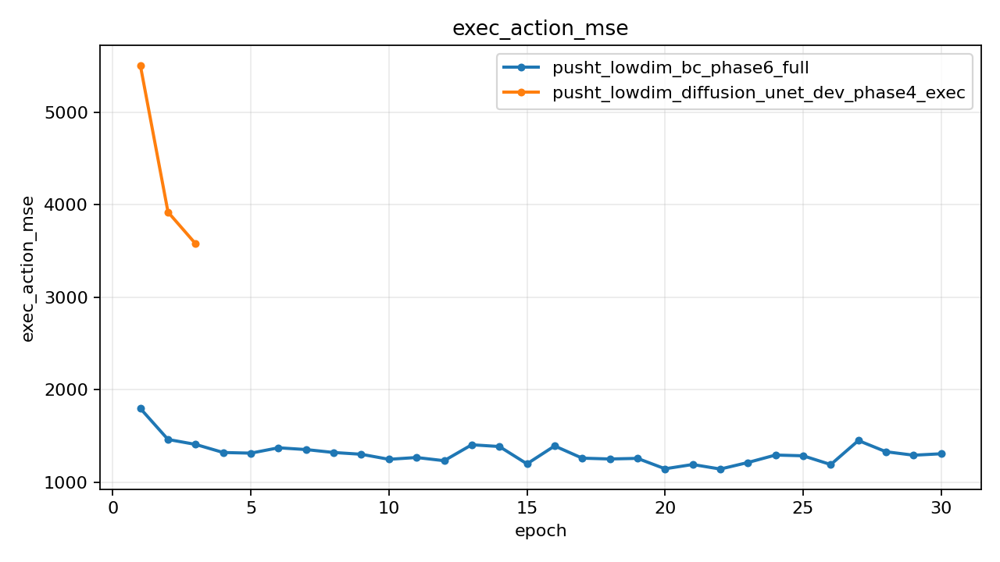
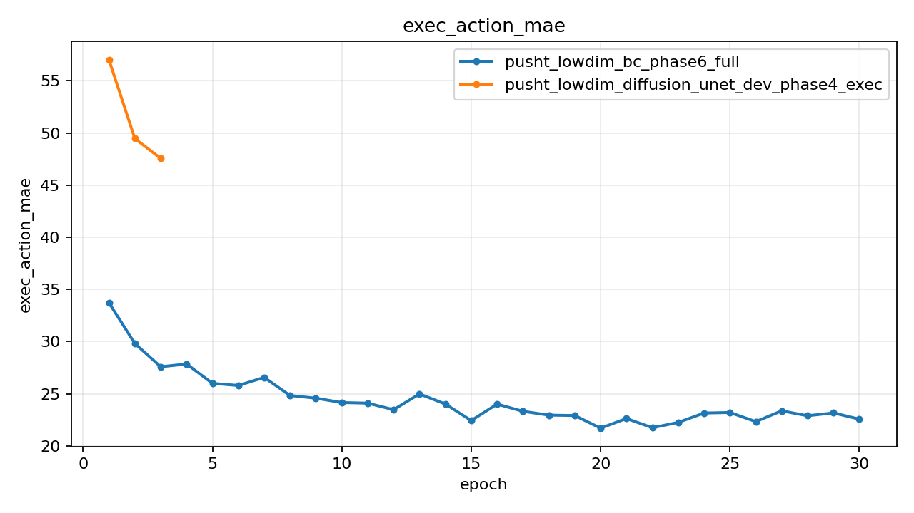
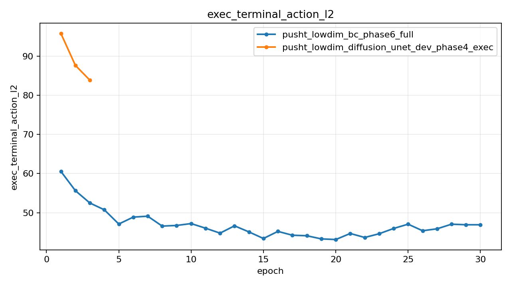

# Push-T Lowdim Rollout Compare V2

## Summary

| Experiment | Monitor | Best | Last Train Loss | Last Action MSE | Last Exec Action MSE | Rollout Success | Rollout Final Coverage | Rollout Max Reward | Checkpoint |
| --- | --- | ---: | ---: | ---: | ---: | ---: | ---: | ---: | --- |
| pusht_lowdim_bc_phase6_full | exec_action_mse (min) | 1142.169647 | 0.034821 | 1533.332947 | 1142.169647 | 0.000000 | 0.481787 | 0.620057 | outputs/pusht_lowdim_bc_phase6_full/best.pt |
| pusht_lowdim_diffusion_unet_dev_phase4_exec | exec_action_mse (min) | 3578.291504 | 0.208668 | 4276.798340 | 3723.637085 | 0.000000 | 0.000000 | 0.110786 | outputs/pusht_lowdim_diffusion_unet_dev_phase4_exec/best.pt |

## Best Epochs

### pusht_lowdim_bc_phase6_full

- Best epoch: 22
- exec_action_mse: 1142.169647
- action_mae: 25.128861
- exec_action_mae: 21.745742
- rollout_success_rate: 0.000000
- rollout_mean_final_coverage: 0.481787
- rollout_mean_max_reward: 0.620057

### pusht_lowdim_diffusion_unet_dev_phase4_exec

- Best epoch: 3
- exec_action_mse: 3578.291504
- action_mae: 50.048500
- exec_action_mae: 47.568628
- rollout_success_rate: 0.000000
- rollout_mean_final_coverage: 0.000000
- rollout_mean_max_reward: 0.110786

## Plots

### train_loss

### action_mse

### action_mae

### terminal_action_l2

### exec_action_mse

### exec_action_mae

### exec_terminal_action_l2

