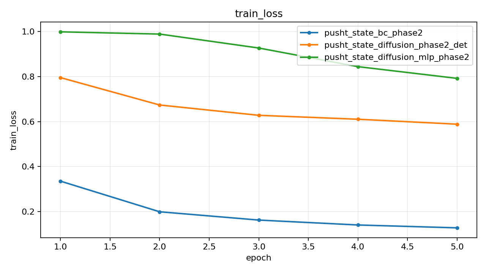
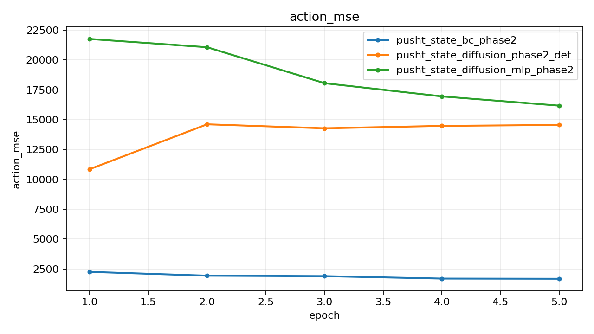
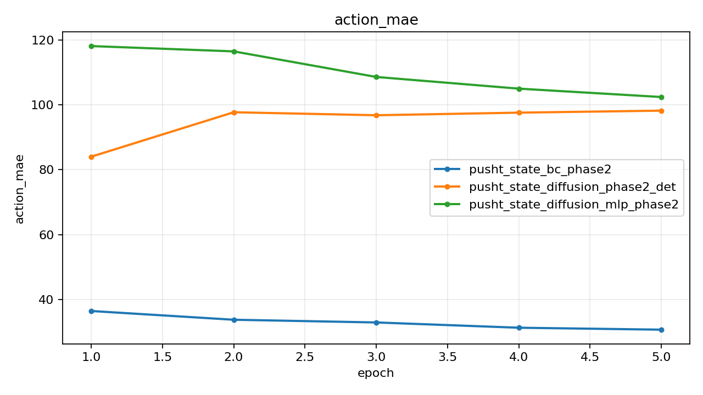
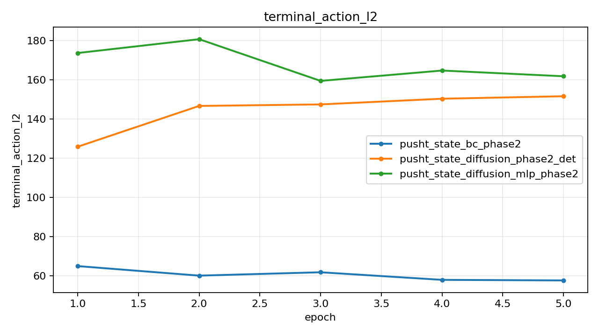

# Push-T State Phase2 Compare

## Summary

| Experiment | Monitor | Best | Last Train Loss | Last Action MSE | Last Action MAE | Checkpoint |
| --- | --- | ---: | ---: | ---: | ---: | --- |
| pusht_state_bc_phase2 | action_mse (min) | 1682.018636 | 0.127511 | 1682.018636 | 30.742734 | outputs/pusht_state_bc_phase2/best.pt |
| pusht_state_diffusion_phase2_det | action_mse (min) | 10852.667318 | 0.588536 | 14556.603190 | 98.204870 | outputs/pusht_state_diffusion_phase2_det/best.pt |
| pusht_state_diffusion_mlp_phase2 | action_mse (min) | 16171.184896 | 0.792247 | 16171.184896 | 102.408173 | outputs/pusht_state_diffusion_mlp_phase2/best.pt |

## Best Epochs

### pusht_state_bc_phase2

- Best epoch: 5
- action_mse: 1682.018636
- action_mae: 30.742734

### pusht_state_diffusion_phase2_det

- Best epoch: 1
- action_mse: 10852.667318
- action_mae: 84.020505

### pusht_state_diffusion_mlp_phase2

- Best epoch: 5
- action_mse: 16171.184896
- action_mae: 102.408173

## Plots

### train_loss

### action_mse

### action_mae

### terminal_action_l2

