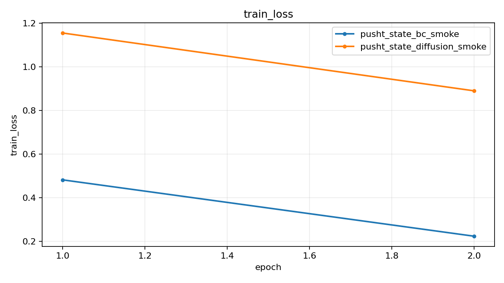
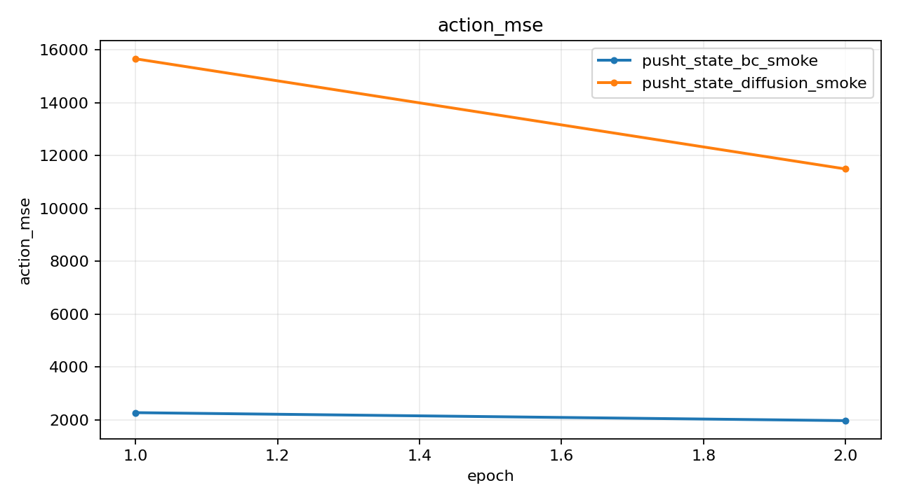
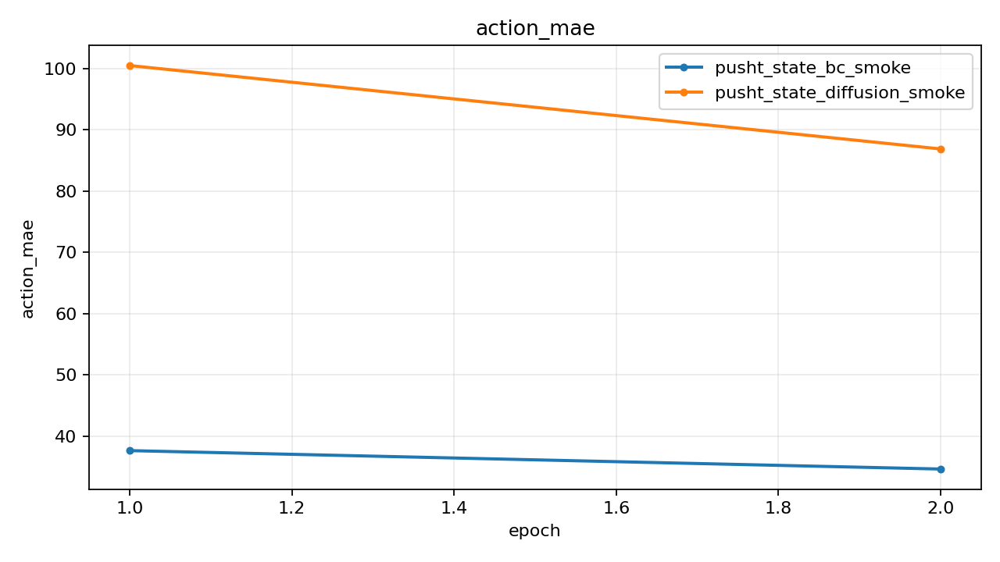
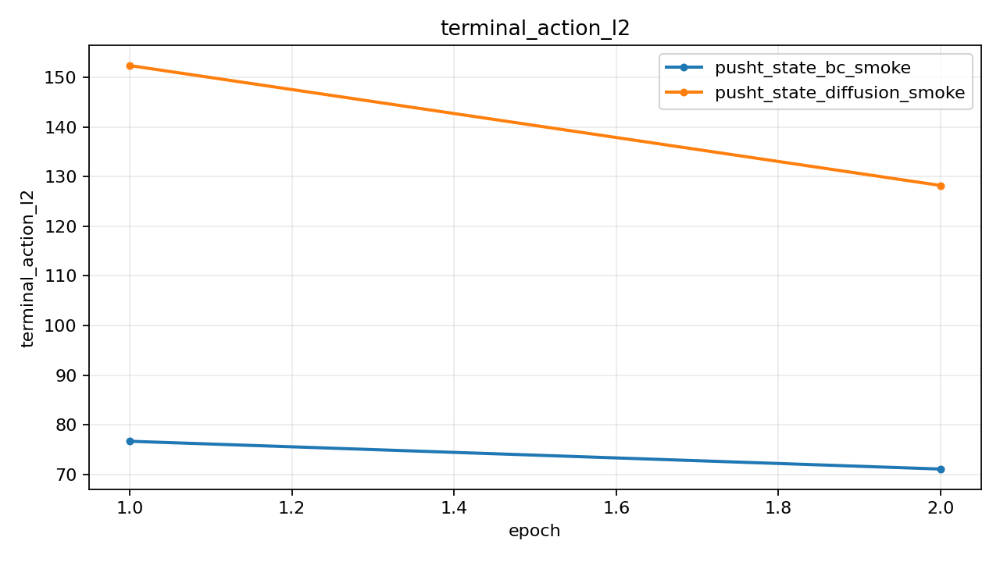

# Push-T State Smoke Report

## Summary

| Experiment | Monitor | Best | Last Train Loss | Last Action MSE | Last Action MAE | Checkpoint |
| --- | --- | ---: | ---: | ---: | ---: | --- |
| pusht_state_bc_smoke | action_mse (min) | 1968.120728 | 0.223940 | 1968.120728 | 34.645017 | outputs/pusht_state_bc_smoke/best.pt |
| pusht_state_diffusion_smoke | action_mse (min) | 11488.512695 | 0.889991 | 11488.512695 | 86.852425 | outputs/pusht_state_diffusion_smoke/best.pt |

## Best Epochs

### pusht_state_bc_smoke

- Best epoch: 2
- action_mse: 1968.120728
- action_mae: 34.645017

### pusht_state_diffusion_smoke

- Best epoch: 2
- action_mse: 11488.512695
- action_mae: 86.852425

## Plots

### train_loss

### action_mse

### action_mae

### terminal_action_l2

