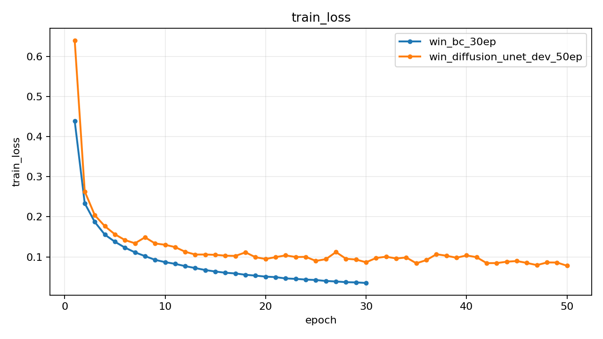
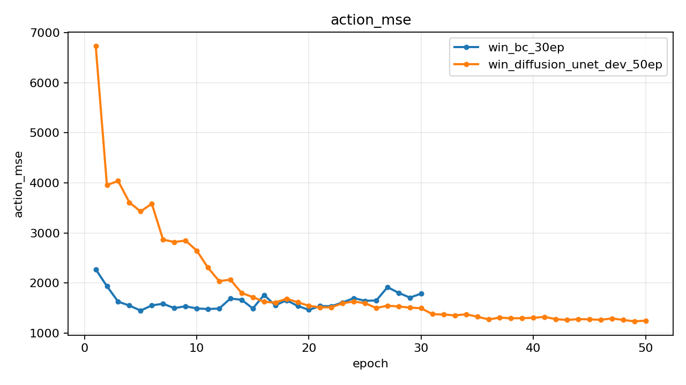
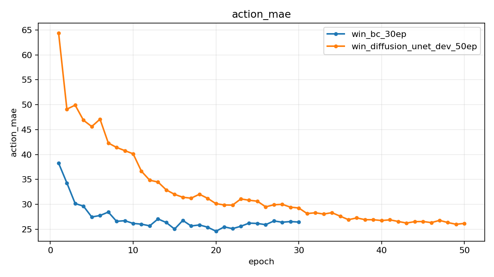
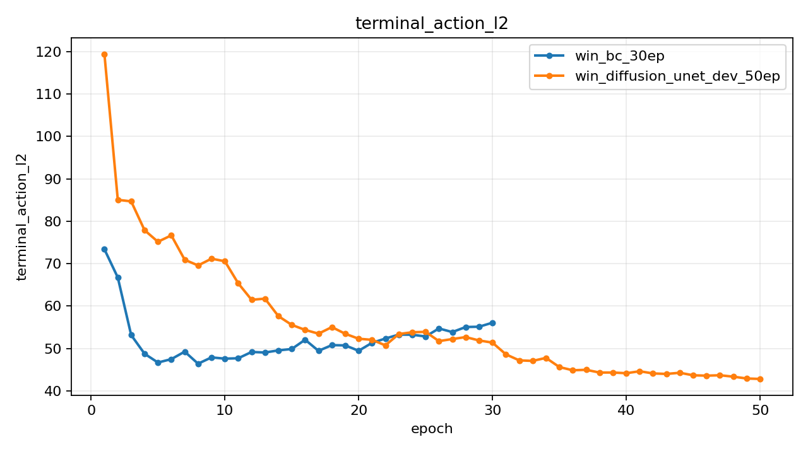
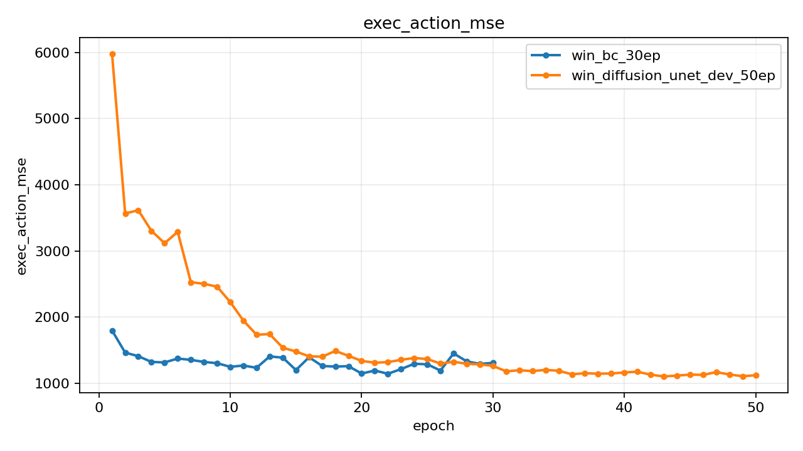
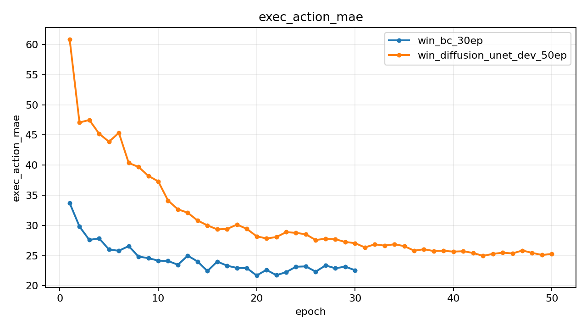
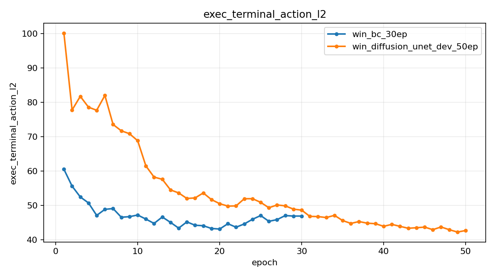

# Experiment Report

## Summary

| Experiment | Monitor | Best | Last Train Loss | Last Action MSE | Last Exec Action MSE | Rollout Success | Rollout Final Coverage | Rollout Max Reward | Best Final Coverage | Checkpoint |
| --- | --- | ---: | ---: | ---: | ---: | ---: | ---: | ---: | ---: | --- |
| win_bc_30ep | exec_action_mse (min) | 1142.170135 | 0.034821 | 1786.528992 | 1307.343201 | n/a | n/a | n/a | n/a | outputs\win_bc_30ep\best.pt |
| win_diffusion_unet_dev_50ep | exec_action_mse (min) | 1101.680969 | 0.077697 | 1277.349976 | 1124.096649 | n/a | n/a | n/a | n/a | outputs\win_diffusion_unet_dev_50ep\best.pt |

## Best Epochs

### win_bc_30ep

- Best epoch: 22
- exec_action_mse: 1142.170135
- action_mae: 25.128880
- exec_action_mae: 21.745745

### win_diffusion_unet_dev_50ep

- Best epoch: 43
- exec_action_mse: 1101.680969
- action_mae: 26.250251
- exec_action_mae: 24.954302

## Training Plots

### train_loss

### action_mse

### action_mae

### terminal_action_l2

### exec_action_mse

### exec_action_mae

### exec_terminal_action_l2

